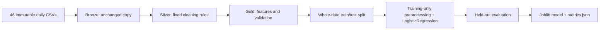

# Delivery delay prediction — Assignment 04

A reproducible, date-aware delivery-delay classification workflow built with
Pandas, Apache Airflow 3.1.0, Docker Compose and Scikit-learn. It ingests one daily
CSV, produces Bronze/Silver/Gold partitions, then trains and evaluates a saved
LogisticRegression baseline. The objective is reliable orchestration; minority-class
recall remains limited.

The Phase 1–7 submission (PR #1) and final JWT issuer correction (PR #2) are
both merged into `main`. The validated release is available from the default
branch, including the tested Airflow authentication configuration.
See the [original requirement checklist](reports/phase7/requirements-checklist.md),
[Phase 7 audit](reports/phase7/validation.md) and
[JWT follow-up results](reports/jwt-followup/validation.md).

## Architecture and repository



`data_pipeline` runs `extract_to_bronze → transform_to_silver → prepare_gold → validate_gold`.
`ml_training_pipeline` runs `load_gold_data → train_model → evaluate_model → save_model`.
ML is manually triggered after validated Gold is available. Every edge requires
upstream success; a failed validation cannot publish a new model.

| Path | Responsibility |
|---|---|
| [Assignment PDF](Route_Assignment_04_Airflow_Data_ML_Pipelines.pdf) | Original three-page specification |
| [data_dictionary.csv](data_dictionary.csv), [original ZIP](Assignment04_46_Daily_CSV_Batches.zip) | Source schema and original dataset |
| [data/raw](data/raw) | All 46 original daily CSVs, unchanged |
| [src/etl.py](src/etl.py), [data DAG](dags/data_pipeline.py) | Reusable dated ETL and orchestration |
| [src/train.py](src/train.py), [ML DAG](dags/ml_training_pipeline.py) | Validated Gold loading, split, fit, evaluation and publication |
| [data/bronze](data/bronze), [data/silver](data/silver), [data/gold](data/gold) | Four committed example dates per layer |
| [models](models), [metrics/metrics.json](metrics/metrics.json) | Fitted pipeline and its evaluated metrics |
| [Dockerfile](Dockerfile), [Compose](docker-compose.yml), [.env.example](.env.example) | Airflow runtime and private local configuration |
| [tests](tests), [scripts](scripts), [workflows](.github/workflows) | Regression, audit and reproducible evidence tools |
| [screenshots](screenshots), [reports](reports) | Genuine UI captures, hashes, logs and execution records |

## Dataset and measured quality

The supplied exercise covers **2026-10-01 through 2026-11-15**, with 15 input
columns. `late_delivery` is the binary label (0 on time, 1 late). These supplied
exercise dates include future-dated batches relative to the execution date;
results are retrospective evaluation of the supplied data.

Pandas exploration inspected all 46 batches, exceeding the three-batch requirement:
**10,219 raw rows**, **10,053 unique orders**, 166 exact duplicate rows/IDs.
Labels: 7,800 on time and 2,419 late (23.67% late, before deduplication).
Missing cells: shipping method 74, distance 142, warehouse load 149, weather risk 94,
carrier reliability 87 (**546** total). Invalid values: 81 nonpositive distances,
98 nonpositive item counts, 55 nonpositive order values. Shipping categories include
whitespace/case variants. No invalid labels or filename/order-date mismatches were found.
October 15–21 has elevated missingness.

Identifiers are `order_id` and `warehouse_id`; `order_date` identifies the batch
and chronological holdout. Categorical inputs include region, shipping method and
weather; numeric fields describe hour, quantity, distance, weight, value, promise,
warehouse load and carrier reliability. Detailed batch/type/category findings:
[exploration report](reports/data_exploration.md), [JSON](reports/exploration_summary.json),
[batch profile](reports/batch_profile.csv), [original hashes](reports/raw_sha256.json).

## ETL rules, engineered features and validation

All ETL functions require a strict, explicit ISO `YYYY-MM-DD`. Stable output paths
are `data/{bronze,silver,gold}/orders_YYYY-MM-DD.csv`; no append or latest-file selection.

- **Bronze:** byte-for-byte raw copy, including bad records, duplicates and CRLF endings.
- **Silver:** remove exact duplicates, reject conflicting repeated `order_id`, sort
  by ID, trim and normalize approved category spellings. Missing/unknown categories
  remain missing. Parse numerics into nullable types; invalid/nonfinite values become
  missing. Hour is integral 0–23; item/promise counts integral ≥1; distance/weight/value
  positive; carrier rate 0–1; warehouse load assumed 0–100 percent. No valid unique
  orders are discarded. Per-date quality reports go to `reports/etl/`.
- **Gold:** retain required fields and target, add `is_weekend` (Saturday/Sunday)
  and `distance_per_promised_day`. The ratio stays missing when an input is missing.
  Both features are available at order placement. IDs/date remain for validation
  and splitting and are excluded from model inputs.
- **Validation:** fail clearly on empty/malformed data, missing columns/IDs, incorrect
  batch dates, nonbinary/missing labels, duplicate IDs in Gold, noncanonical
  categories, invalid numerics or inconsistent engineered features. Silver first
  removes exact duplicates and rejects conflicting IDs; Bronze deliberately preserves them.

Silver uses fixed rules. Median/mode imputation, scaling and category vocabularies
are learned only inside training. Gold CSV serialization uses 12 significant digits;
ratio validation allows its rounding precision.

| Committed date | Bronze rows | Silver rows | Gold rows | Exact duplicates removed |
|---|---:|---:|---:|---:|
| 2026-10-01 | 183 | 180 | 180 | 3 |
| 2026-10-18 | 248 | 245 | 245 | 3 |
| 2026-10-19 | 183 | 180 | 180 | 3 |
| 2026-10-20 | 196 | 193 | 193 | 3 |

## Installation and Docker Compose reproduction

Use Linux containers, Docker Compose v2 (2.20+), Python 3 on the host, at least
2 CPUs/4 GB Docker RAM (8 GB recommended), 20 GB free Docker storage and a shared
filesystem supporting POSIX `flock`. Docker Desktop must share the repository;
WSL users should use its Linux filesystem.

```sh
git clone --branch main https://github.com/Ibraheim11/assignment04-delivery-delay.git
cd assignment04-delivery-delay
python3 scripts/setup_docker_env.py
docker compose config --quiet
docker compose build
docker compose up --exit-code-from airflow-init airflow-init
docker compose up -d --wait
docker compose ps
docker compose run --rm airflow-cli python -m scripts.container_smoke
```

The setup script creates a private `.env` with separate random DB/admin/JWT/Fernet
secrets and host UID, plus writable output directories. It refuses to overwrite
existing secrets. Alternatively fill every secret in `.env.example` and save it as
`.env`. Do not commit it. The raw mount is read-only; the image build context excludes
code, data and secrets. Managed proxy builds can supply the optional `proxy_ca`
BuildKit secret described in the Dockerfile; keep TLS verification enabled.

Open **http://localhost:8080**, log in with `AIRFLOW_ADMIN_USER` and
`AIRFLOW_ADMIN_PASSWORD` from the local `.env`. PostgreSQL 16 stores Airflow metadata;
the API/UI, scheduler with LocalExecutor, DAG processor and triggerer use shared
code/data/artifact/log mounts. Initialization migrates metadata and creates the FAB
admin. DAGs start paused. No credentials or database files are submitted.
Shared Compose settings include the same nonempty JWT issuer used by the successful
hosted UI capture; this avoids FAB login failures with the Docker-resolved PyJWT 2.15.1
([exact-version compatibility probe](reports/jwt-followup/compatibility.json)).
For an existing deployment, recreate the Airflow services with `docker compose up -d --wait`
and log in again so all components and new tokens use the shared issuer.
With services running, `python3 scripts/verify_airflow_auth.py` checks live FAB login,
authenticated DAG access and the UI HTML route without persisting tokens.

For a deterministic first execution while DAGs remain paused:

```sh
docker compose run --rm airflow-cli airflow dags list --local
docker compose run --rm airflow-cli airflow dags list-import-errors --local
docker compose run --rm airflow-cli airflow dags test data_pipeline 2026-10-18 \
  --conf '{"batch_date":"2026-10-18"}'
docker compose run --rm airflow-cli python -m scripts.generate_gold
docker compose run --rm airflow-cli airflow dags test ml_training_pipeline 2026-11-06
docker compose run --rm airflow-cli python -m scripts.container_smoke \
  --check-gold --baseline reports/phase4_execution.json
```

Gold generation validates all **46** dates before default ML training. Only four
example dates are committed; the other partitions, quality reports and UUID ML
intermediates are regenerable and ignored. `dags test` uses real Airflow execution
and metadata, but queued scheduler execution is demonstrated separately in the
hosted evidence. To queue runs with healthy services:

```sh
docker compose exec airflow-scheduler airflow dags unpause data_pipeline
docker compose exec airflow-scheduler airflow dags trigger data_pipeline \
  --conf '{"batch_date":"2026-10-18"}'
# Wait for all four data tasks to succeed. Generate all Gold as above, then:
docker compose exec airflow-scheduler airflow dags unpause ml_training_pipeline
docker compose exec airflow-scheduler airflow dags trigger ml_training_pipeline
# Monitor both pipelines in the UI; pause the finite daily dataset when finished:
docker compose exec airflow-scheduler airflow dags pause data_pipeline
docker compose down
```

Unpausing also enables the daily schedule. Do not overlap direct ETL/generation
commands with training or another writer. `docker compose down` retains the DB
volume; adding `--volumes` permanently deletes local Airflow run history.

## Date handling, retries, idempotency and historical backfill

The daily data DAG uses UTC, fixed start 2026-10-01, `catchup=False`, `retries=2`,
five-minute retry delay and `max_active_runs=1`. Manual runs **require**
`dag_run.conf.batch_date`, independent of the run's logical date. Daily data
intervals process their start date; Airflow 3.1's default midnight point timetable
processes the preceding day. Automated conf overrides and non-daily intervals fail.
The November 16 midnight schedule selects the last supplied batch, November 15;
subsequent missing source dates fail, retry twice and block downstream tasks.

Per-date atomic replacement and advisory locks prevent appends and conflicting
DAG writes; backfills also need `--max-active-runs 1`. Direct `python -m src.etl`
does not take DAG locks. Individual files are atomic; a whole run is not a transaction.

To reproduce native historical backfill, configure **all** Airflow services to use
data intervals before restarting and reserializing. Create `work/compose.backfill.yml`:

```yaml
x-interval: &interval
  environment:
    AIRFLOW__SCHEDULER__CREATE_CRON_DATA_INTERVALS: 'true'
services:
  airflow-init: *interval
  airflow-apiserver: *interval
  airflow-scheduler: *interval
  airflow-dag-processor: *interval
  airflow-triggerer: *interval
  airflow-cli: *interval
```

```sh
mkdir -p work
# Save the YAML above to work/compose.backfill.yml, then use both files consistently:
docker compose -f docker-compose.yml -f work/compose.backfill.yml up -d --wait
docker compose -f docker-compose.yml -f work/compose.backfill.yml exec airflow-scheduler airflow dags reserialize
docker compose -f docker-compose.yml -f work/compose.backfill.yml exec airflow-scheduler airflow dags unpause data_pipeline
docker compose -f docker-compose.yml -f work/compose.backfill.yml exec airflow-scheduler \
  airflow backfill create --dag-id data_pipeline --from-date 2026-10-18 --to-date 2026-10-20 \
  --max-active-runs 1 --reprocess-behavior completed
```

Wait for three successful runs and the parent backfill's completion before
repeating October 18 (`--from-date 2026-10-18 --to-date 2026-10-18`). Airflow 3.1
reuses the historical DagRun with a new backfill association and higher attempts.
The [observed Phase 6 results](reports/phase6/validation.md) show three Gold dates,
byte-identical October 18 reruns (245 Gold rows, zero duplicate IDs), unchanged raw
hashes, extraction failure on try 1 followed by success on try 2, and an exhausted
three-attempt failure with descendants `upstream_failed`, zero tries and no worker PID.

The safe fault hook requires CI opt-in, a `phase6-` run ID and explicit fault conf;
it raises before any extraction write. Hosted CI uses 30-second delays for bounded
execution; production remains five minutes. The manual reliability workflow
reproduces this experiment without asking reviewers to corrupt source files.

## ML methodology, actual performance and limitations

The saved Pipeline uses 13 order-time inputs: ten numeric fields (including both
engineered features) with training-only median imputation and StandardScaler, plus
region/shipping/weather with training-only mode imputation and OneHotEncoder
(unknown categories ignored). Entirely missing numeric training columns use zero.
`order_id`, `warehouse_id`, raw date and target are excluded from inputs.
The classifier is unchanged: `LogisticRegression(solver="lbfgs", max_iter=2000,
random_state=42)`, default class weights, threshold 0.5. No holdout tuning was done.

All dates are validated and cross-date repeated IDs rejected before splitting.
Earliest `floor(0.8 × 46) = 36` whole dates train; latest ten test. Preprocessing
is fitted only on training, and evaluation reloads the candidate and predicts.

| Split | Dates (inclusive) | Rows | On time | Late |
|---|---|---:|---:|---:|
| Train | 2026-10-01–2026-11-05 | 7,680 | 5,999 | 1,681 |
| Test | 2026-11-06–2026-11-15 | 2,373 | 1,675 | 698 |

| Held-out metric | Actual value |
|---|---:|
| Accuracy | 0.7332490518331226 |
| Precision (late=1) | 0.6190476190476191 |
| Recall (late=1) | 0.24212034383954154 |
| F1 (late=1) | 0.34809474768280124 |

Confusion matrix `[0,1]`, rows actual/columns predicted:
`[[1571,104],[529,169]]`. Always predicting on time scores 70.59% accuracy;
this baseline misses **529 late deliveries**, so its accuracy alone is insufficient
for operational use. The supplied dataset and chronological holdout are limited;
no production generalization or highest-accuracy claim is made.

[models/delivery_delay_model.joblib](models/delivery_delay_model.joblib) contains
fitted preprocessing/classifier; [metrics/metrics.json](metrics/metrics.json)
records scores, counts, dates, features, seed and the model's SHA-256. Publication
checks the evaluated candidate hash. Model and metrics are separate atomic writes;
a crash between them can leave a detectable mismatch. UUID staging directories
remain for diagnosis; remove obsolete intermediates only after runs finish.
Use trusted Joblib files and the pinned Python/package versions; platform-dependent
floating-point differences are possible. Image tags and transitive dependencies
are not a complete image lock. Workers require shared POSIX storage.

## Regression tests, Actions and durable evidence

For host development use Python 3.12 and an isolated environment/database:

```sh
python3.12 -m venv .venv
. .venv/bin/activate
python -m pip install 'apache-airflow==3.1.0' \
  --constraint https://raw.githubusercontent.com/apache/airflow/constraints-3.1.0/constraints-3.12.txt
python -m pip install -r requirements-dev.txt
python -m pip check
export AIRFLOW_HOME="$PWD/work/airflow-dev"
export AIRFLOW__DATABASE__SQL_ALCHEMY_CONN="sqlite:///$AIRFLOW_HOME/airflow.db"
export AIRFLOW__CORE__DAGS_FOLDER="$PWD/dags"
export AIRFLOW__CORE__LOAD_EXAMPLES=False
airflow db migrate
airflow dags reserialize
python -m pytest -q
RUN_AIRFLOW_INTEGRATION=1 python -m pytest -q
python -m scripts.audit_submission --output work/submission-audit.json
```

Database migration/serialization is needed even for default DAG-discovery tests.
Opt-in tests execute isolated data/model runs against this development metadata DB;
they must not use production metadata. Local socket access is required by Airflow's
in-process Execution API. The audit independently compares every raw byte to the
ZIP, regenerates all dates twice in disposable `work/`, reloads the existing model,
recomputes metrics, verifies screenshot hashes and checks local links/runtime-file
hygiene/credential patterns. It preserves submitted CSVs and model artifacts.

Actual final local results: **95 passed, 14 skipped** by default; **109 passed,
7 existing FastAPI deprecation warnings** with integration enabled. See the
[final audit report](reports/phase7/validation.md) for logs, initial setup failures,
hosted results and limits.

| Workflow | Final trigger policy and purpose |
|---|---|
| [Regression tests](.github/workflows/regression.yml) | PRs targeting `main`, pushes to `main`, manual dispatch; complete host suite and artifact audit |
| [Docker Airflow integration](.github/workflows/docker-integration.yml) | Manual dispatch; clean image build, healthy services, both real scheduler DAG runs, artifact checks and container regression |
| [Reliability evidence](.github/workflows/reliability.yml) | Manual dispatch; Docker integration plus real backfill/rerun/retry/failure and live UI capture |

Workflows use `contents: read` and do not push evidence or alter another branch.
After these workflow files reach the default branch, use Actions → select workflow
→ **Run workflow**, choose the desired ref. Before merge, GitHub may not expose
manual dispatch for new workflow files; the final evidence was bootstrapped by one
restricted branch push, whose temporary trigger is removed in the submitted tree.
Actions uploads expire after 14 days; selected genuine reports/logs/screenshots
remain in Git. Test failures and capture limitations are retained explicitly.

Final hosted [run 42242189893](https://github.com/Ibraheim11/assignment04-delivery-delay/actions/runs/42242189893)
passed Docker execution, backfill/retry/rerun checks, all **109** container tests
and ten live UI captures; three supplementary captures are committed alongside the
original seven. Full provenance/results are in the final audit report.

Earlier successful hosted runs: [Docker 42227343176](https://github.com/Ibraheim11/assignment04-delivery-delay/actions/runs/42227343176)
and [reliability 42237926425](https://github.com/Ibraheim11/assignment04-delivery-delay/actions/runs/42237926425).
The [Phase 5B report](reports/phase5b_validation.md) and [Phase 6 report](reports/phase6/validation.md)
record their tested commits and actual results. Earlier phase reports describe their
historical scope; this README and the Phase 7 checklist describe the final submission.

Real Airflow evidence:
[successful data graph and retry logs](screenshots/phase6/retry-first-failed-attempt-logs.png),
[successful backfill tasks](screenshots/phase6/backfill-successful-tasks.png),
[backfill and same-date reprocessing records](screenshots/phase6/historical-backfills.png),
[ML graph](screenshots/phase6/ml-training-graph.png),
[screenshot provenance](reports/phase6/screenshots.json),
[durable task logs and metadata](reports/phase6),
[successful ML task graph](screenshots/phase7/ml-successful-task-graph.png),
[ML evaluation logs](screenshots/phase7/ml-evaluation-task-logs.png),
[same-date rerun history](screenshots/phase7/same-date-rerun-task-history.png),
and [final hosted run and evidence](reports/phase7/validation.md).
The Phase 6 DAG overview is red because its last run is the deliberate exhausted
failure; the successful per-run views and recorded attempt history provide context.

## Assignment acceptance checklist

- [x] All three PDF pages reviewed and every numbered requirement mapped to evidence.
- [x] 46 original daily files unchanged; Pandas exploration and quality findings recorded.
- [x] Bronze/Silver/Gold, two engineered features and explicit validation failures.
- [x] Four dated examples in each layer; daily data DAG and correct four-task dependencies.
- [x] Gold-only ML DAG; chronological split and training-only preprocessing.
- [x] Evaluated Joblib model and separate metrics with counts/date ranges.
- [x] Docker Compose service/runtime evidence and reproducible commands.
- [x] Real retry, identical same-date rerun and three-date historical backfill evidence.
- [x] Genuine UI graphs, task states and logs; screenshot hashes and source-run provenance.
- [x] Regression tests, repository hygiene and durable evidence reviewed.

The [detailed checklist](reports/phase7/requirements-checklist.md) distinguishes
required items, evidence limitations, optional bonuses and final PR status.
